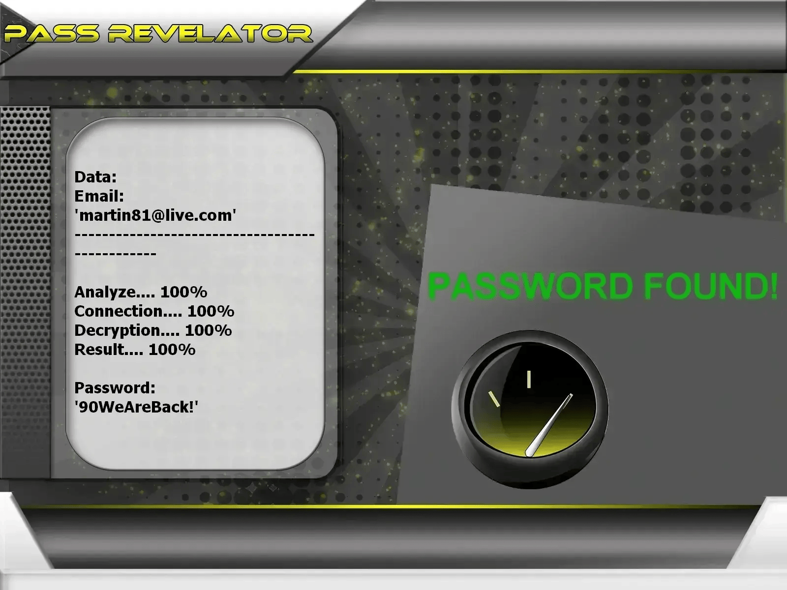

# 🔐 Hack Outlook Account 2026 — Ethical Hacker & Password Cracker Tool | Educational Use Only

**Microsoft credential auditor powered by AI — training labs, Azure-compatible, owned accounts only.**


> **Keywords:** hack Outlook account, Outlook hacker, cracker Microsoft password, email hacking tool, ethical hacking, Azure security audit, cybersecurity 2026

---

## ⚠️ Legal Notice — Read Before Use

**This GitHub repository is limited to EDUCATION, RESEARCH, and AUTHORIZED SECURITY TESTING.**

Attempting to **hack**, **crack**, or break into an Outlook or Azure mailbox you do not own — without written consent — is a **criminal offense**. By running this software, you agree to lawful, responsible use only.

**Powered by the PASS REVELATOR API** to illustrate credential-analysis concepts. For deeper reading on email protection and **password-hacking** risks, visit:  
**[https://www.passwordrevelator.net/en/passrevelator](https://www.passwordrevelator.net/en/passrevelator)**



- 🚫 **Illegal use forbidden**: Accessing third-party Outlook accounts without permission is unlawful
- ✅ **Authorization mandatory**: Test only inboxes you created or environments covered by a signed audit letter
- 🔐 **Educational objective**: Expose weak-password patterns and promote strong authentication
- ⚖️ **User responsibility**: You alone must comply with all applicable laws

---

## 🧭 What Is This Tool?

The **Outlook Password Security Analyzer** is a Python lab framework for Microsoft ecosystems. It shows how a **cracker** targets predictable credentials on Outlook and **Azure AD** — and how an **ethical hacker** converts those findings into stronger policies.

Every module is scoped to simulation and reporting on infrastructure you control — never random third-party mailboxes.

---

## 🎓 Skills You Will Build

| Objective | Expected outcome |
| --------- | ---------------- |
| Understand **password hacking** on Microsoft stacks | Replay dictionary, mask, hybrid, and brute-force flows safely |
| Benchmark owned accounts | Measure resilience on `@outlook.com` or Azure test tenants |
| Harden defenses | Draft password rules, enable MFA, and review OAuth scopes |
| Study OAuth2 / Azure AD | Explore login flows, token lifecycles, and Graph API guardrails |
| Azure integration | Register an app, configure Graph permissions, and run authorized audits |

---

## ✨ Built-In Modules

### 🔑 Credential Analysis Modes

| Mode | Description |
| ---- | ----------- |
| **Dictionary pass** | Tests entries against standard or custom wordlists |
| **Mask generation** | Builds candidates from charset patterns (`?l`, `?u`, `?d`, `?s`) |
| **Rule mutations** | Transforms base terms (`outlook2024` → `0utl00k2024!`) |
| **Hybrid pipeline** | Chains strategies for broader coverage |

### 🌐 Operational Layer

- Automatic proxy rotation during runs
- Optional **Tor** routing for anonymous lab traffic
- Adaptive throttling to respect Microsoft rate limits
- User-Agent and browser fingerprint randomization

### 📊 Monitoring & Reports

- Live progress and success-rate statistics
- CPU/RAM tracking via `psutil`
- Detailed, exportable log output

### 🔒 Authentication Handling

- CSRF token processing
- Outlook / Microsoft login-flow simulation
- Secure session lifecycle management
- CAPTCHA detection with graceful abort

---

## 🚀 Installation

### Requirements

- Python **3.8+**
- `pip` package manager
- Stable Internet connection
- An Outlook or Azure **test account you own**

### Step 1 — Clone the Repository

```bash
git clone https://github.com/HoffmannAlex/Hack-Outlook-Account-with-AI.git
cd outlook-password-tool
```

### Step 2 — Install Dependencies

```bash
pip install -r requirements.txt
```

**Core libraries:**

- `aiohttp>=3.8.0`
- `requests>=2.28.0`
- `cryptography>=3.4.0`
- `stem>=1.8.0`
- `psutil>=5.9.0`

### Step 3 — Configure Azure AD Application

1. Open the [Azure Portal](https://portal.azure.com)
2. Create a new **App Registration**
3. Copy the **Client ID** and generate a **Client Secret**
4. Grant **Microsoft Graph** API permissions
5. Paste credentials into `config.json`

### Step 4 — Verify Setup

```bash
python hack_outlook.py --help
```

---

## ⚡ Quick Start (Authorized Accounts Only)

**Standard wordlist audit**

```bash
python hack_outlook.py --email your_account@outlook.com --password-list passwords.txt
```

**Tor-routed lab session**

```bash
python hack_outlook.py --email your_account@outlook.com --password-list passwords.txt --use-tor
```

**Multi-threaded run with jitter**

```bash
python hack_outlook.py --email your_account@outlook.com --password-list passwords.txt --threads 4 --use-tor --min-delay 2 --max-delay 5
```

**Proxy rotation**

```bash
python hack_outlook.py --email your_account@outlook.com --password-list passwords.txt --proxy-list proxies.txt --threads 3
```

> ⚠️ Replace `your_account@outlook.com` with an address **you control**.

---

## 🔥 Supported Cracking Strategies

### 1. Dictionary Audit

```bash
python hack_outlook.py --email target@outlook.com --password-list common_passwords.txt
python hack_outlook.py --email target@outlook.com --password-list custom_list.txt
```

### 2. Mask Attack

```
?l?l?l?d?d?d   # e.g. abc123
?u?l?l?l?d?d   # e.g. Abcd12
?l?l?l?l?s?d   # e.g. abcd!1
```

### 3. Combination Strategy

```bash
python hack_outlook.py --email target@outlook.com --strategy combination --base-words "password,outlook,user"
```

### 4. Brute-Force Simulation (Educational Only)

```bash
python hack_outlook.py --email target@outlook.com --strategy brute --min-length 4 --max-length 8
```

> Brute force against live Microsoft endpoints is slow and illegal without authorization. Reserve this mode for isolated labs.

---

## 📝 Configuration

Edit `config.json` with your Azure AD application credentials:

```json
{
    "azure_ad": {
        "client_id": "your_client_id",
        "client_secret": "your_client_secret",
        "authority": "https://login.microsoftonline.com/common",
        "scopes": ["https://graph.microsoft.com/.default"]
    },
    "app": {
        "user_agent": "OutlookSecurityTester/1.0",
        "timeout": 30,
        "max_retries": 3
    }
}
```

---

## ❓ FAQ — Hack, Crack, or Break Into Outlook?

**Hacker vs cracker — what's the difference?**  
Hackers study systems to strengthen them. Crackers break in without permission. This repo serves the first group.

**Can I legally hack my own Outlook account?**  
Yes — on mailboxes you created or Azure tenants covered by written consent. Hacking someone else's inbox is a crime.

**Why do crackers sometimes succeed on Microsoft accounts?**  
Password reuse, missing MFA, legacy auth protocols, and phishing — vectors this toolkit helps you understand on **your** accounts.

**Does this work with Azure AD?**  
Yes — the tool supports Azure app registration and Microsoft Graph for authorized lab environments.

**Will this hack any Outlook account?**  
No. Strong unique passwords, MFA, and Conditional Access policies block most classic attacks. The goal is **prevention**.

---

## ⚖️ Legal & Ethical Considerations

Distributed for educational and authorized security testing only. Authors assume no liability for misuse. The end user must obey all applicable laws.

**CRITICAL**: Only test accounts you own or have explicit permission to audit. Unauthorized system access is illegal in most jurisdictions.

---

## 📜 License

Licensed under **ECL-2.0** (Educational Community License v2.0). See the `LICENSE` file for full terms.

---

## 🙏 Acknowledgments

- Microsoft Graph API team
- Open-source security community
- Educational institutions promoting responsible ethical hacking

> ⭐ Star the repository if this framework accelerated your security learning!
